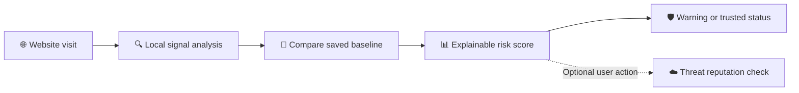

# 🛡️ BaselineSentry

### Adaptive Website Trust Monitor

*Trust the website. Verify the change.*

**[🌐 Open live demo](https://baseline-sentry-docs.vercel.app/)** · **[🔎 Explore features](#included-features)** · **[🔌 Install extension](#run-locally-in-chrome)**

---

## 🎯 Project overview

BaselineSentry is a privacy-first phishing defence system that detects phishing signals and warns when a website's structure changes after the user has marked it as trusted.

| 🌐 Public website | 🧩 Browser extension |
| --- | --- |
| Mobile-friendly URL checker, interactive demo, system architecture, and privacy explanation. | Automatic page scanning, form warnings, adaptive trust monitoring, and an evidence timeline on desktop Chromium browsers. |
| [Open live demo →](https://baseline-sentry-docs.vercel.app/) | Load the local `extension/` folder in Chrome or Edge. |

## Live demo

**Public website:** [baseline-sentry-docs.vercel.app](https://baseline-sentry-docs.vercel.app/)

The responsive public website works on desktop and mobile browsers. It includes a local URL checker, interactive risk walkthrough, system architecture, and privacy information. The browser extension provides the full automatic in-page scanning and adaptive trust-monitoring experience on desktop Chromium browsers.

## Included features

### 🧩 Browser extension

- 🔍 **Real-time page analysis** of URL structure, login/payment forms, redirects, and third-party resources.
- 🎭 **Visual domain-deception detection** for look-alike brand patterns, misleading hostname structure, punycode, and IP-address hosts.
- 🔐 **Safe sensitive-form warnings**, especially where credentials could be submitted to another origin. Passwords and form values are never captured or stored.
- 🧠 **Adaptive Website Trust Monitor:** save a trusted page structure locally and detect meaningful changes such as a new credential form, a changed form destination, or unfamiliar external origins.
- 📊 **Explainable risk scoring and evidence timeline** so each warning is supported by visible findings.
- ⚡ **Automatic local scan** after a page loads, with a bottom-right warning for caution, high-risk, or critical results. It can be disabled in the popup.
- ☁️ **Optional API second opinion** using only minimized structural signals.
- 🛑 **Manual threat-reputation check** for the current URL using OpenPhish Community Feed, URLhaus when configured, and VirusTotal when configured.

### 🌍 Public website

- 📱 Responsive landing page for desktop and mobile.
- 🔗 **Paste a link to check** tool that analyses URL and domain-deception signals locally in the browser.
- ⚠️ Optional threat-reputation lookup that separates confirmed blacklist results from single-provider caution signals.
- 🧪 Interactive trusted-versus-changed login scenario showing adaptive risk reassessment.
- 🗺️ Visual explanation of the detection pipeline, privacy guarantees, and project architecture.

### 🔐 Privacy and safety

- ✅ Local analysis is the default; benign browsing history is not uploaded.
- ✅ Passwords, form values, page HTML, and screenshots are never stored or sent.
- ✅ External reputation checks only run after a user clicks the button. A URL that is not listed is **not** assumed safe.
- ✅ Provider keys remain server-side in Render and are never included in the public website or extension.

## 🧭 Detection workflow

## Run locally in Chrome

1. Open Chrome and visit `chrome://extensions`.
2. Enable **Developer mode**.
3. Select **Load unpacked**.
4. Choose the `extension` folder in this repository.
5. Open a regular webpage, then click the BaselineSentry extension icon.

For the first test, open a normal site, choose **Trust current structure**, then open a test page with a password form posting to another origin. The risk score and evidence timeline should change.

## 🛣️ Future improvements

1. Improve registrable-domain parsing with `tldts`.
2. Add more benign institutional-login fixtures to further reduce false positives.
3. Expand verification tests and provider-resilience monitoring.
4. Publish a Chrome/Edge extension listing after security and privacy review.

## 🚀 Deployment

| Component | Host | Link |
| --- | --- | --- |
| 🌐 Public website | Vercel | [Open BaselineSentry](https://baseline-sentry-docs.vercel.app/) |
| ☁️ Threat-classification API | Render | [Check API health](https://baselinesentry-api.onrender.com/health) |
| 🧩 Extension | Chrome / Edge | Load `extension/` locally during development |

> [!IMPORTANT]
> Threat reputation combines the keyless OpenPhish Community Feed with URLhaus and VirusTotal when configured. API keys (`URLHAUS_AUTH_KEY` and `VIRUSTOTAL_API_KEY`) remain only in Render. An unlisted result is never treated as safe.

---

Built for **Hackathon 2026** · Security that explains itself. 🛡️

